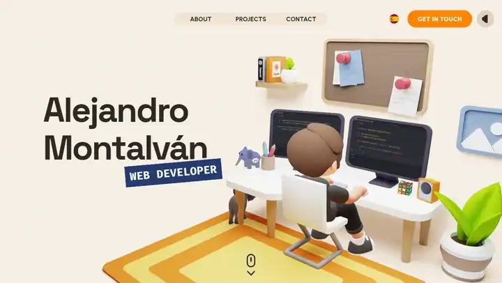
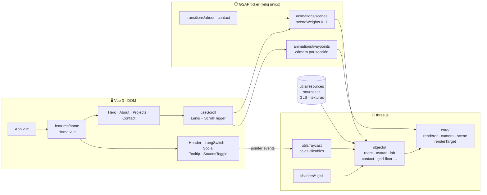
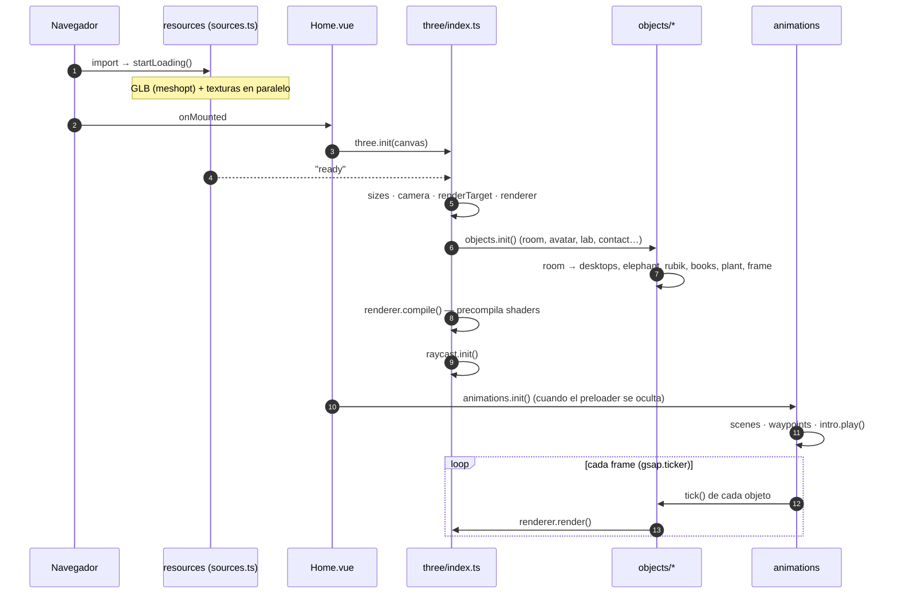
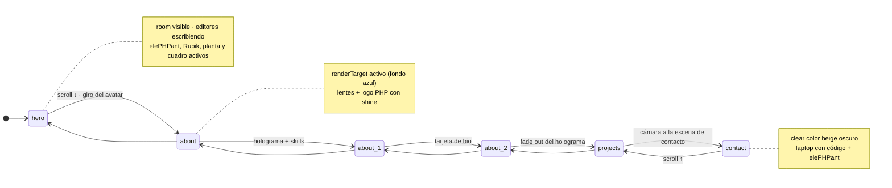
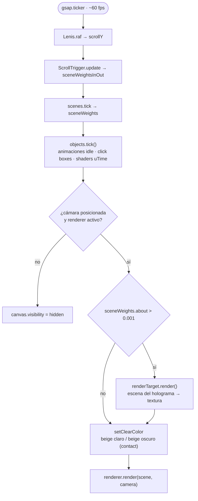
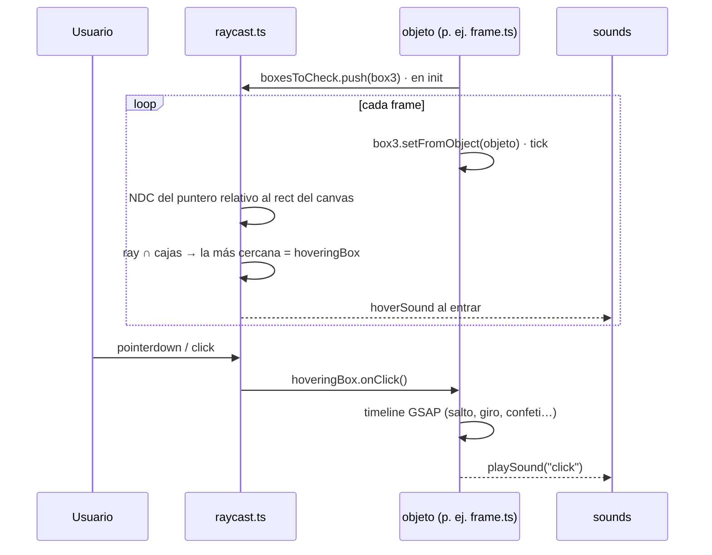
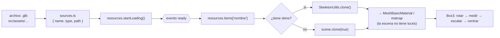
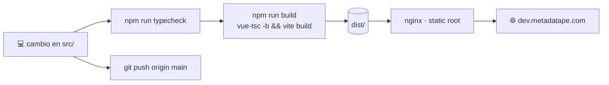

# Portfolio Vue 🆚

[](https://forthebadge.com)
[](https://www.linkedin.com/in/drphp/)

<a href="https://www.instagram.com/amvsoft.tech/">
  
</a>

▶️ **Video completo (WebM, 34 s):** [`docs/media/portfolio-demo.webm`](docs/media/portfolio-demo.webm) · 🌐 **En vivo:** [dev.metadatape.com](https://dev.metadatape.com)

> 🧩 **Portfolio personal interactivo** de un desarrollador PHP / Laravel. La interfaz es Vue 3 y, detrás, una sola escena `three.js` (habitación, avatar, holograma, contacto) que se recorre con el scroll. Tiene objetos con los que se puede interactuar, código que se escribe solo en los monitores, shaders GLSL propios, audio y soporte para «reducir movimiento».

---

## Tabla de contenido

- [Highlights](#highlights)
- [Stack](#stack)
- [Arquitectura](#arquitectura)
- [Ciclo de vida: del arranque al primer frame](#ciclo-de-vida-del-arranque-al-primer-frame)
- [Scroll → escenas → cámara](#scroll--escenas--cámara)
- [Render loop](#render-loop)
- [Interacción 3D (raycast)](#interacción-3d-raycast)
- [Estructura del proyecto](#estructura-del-proyecto)
- [Recursos 3D y assets](#recursos-3d-y-assets)
- [Puesta en marcha](#puesta-en-marcha)
- [Build y despliegue](#build-y-despliegue)
- [Guía: agregar un objeto interactivo](#guía-agregar-un-objeto-interactivo)
- [Contenido, i18n y audio](#contenido-i18n-y-audio)
- [Accesibilidad y rendimiento](#accesibilidad-y-rendimiento)
- [Gotchas conocidos](#gotchas-conocidos)
- [Verificación de cambios](#verificación-de-cambios)

---

## Highlights

| Zona | Qué pasa |
| --- | --- |
| **Hero, la habitación** | El avatar programa y en los dos monitores corre un editor de código real, dibujado en canvas y escrito tecla a tecla. Hay un elePHPant cartoon (hecho con primitivas) que barrita al hacer clic, un cubo Rubik que se resuelve solo, una planta que se mece con un shader de vértices, libros con los logos de Claude y OpenAI y un cuadro sorpresa (Laravel → Symfony → FrankenPHP). |
| **About, el holograma** | La cámara gira hacia el avatar, que se disuelve en un holograma azul (render target aparte). Aparecen tarjetas de skills, los lentes y el logo PHP con brillo y aura. |
| **Projects** | Grilla de casos de estudio con transición de página y su propio smooth scroll. |
| **Contact** | El avatar, cajas de mudanza y una laptop con código en vivo. A su lado, otro elePHPant con la trompa en el teclado. |
| **UI** | Header con tooltips, cambio de idioma `es`/`en`, botón de sonido y «Ponte en contacto», que abre WhatsApp con el saludo ya escrito en el idioma de la página. |

## Stack

| Capa | Tecnología | Rol |
| --- | --- | --- |
| UI | **Vue 3** (`<script setup>`) + **TypeScript** | Componentes, router propio y estado con `ref` |
| Build | **Vite 7** + `vite-plugin-glsl` | Dev server y bundling; importa los shaders `.glsl` como módulos |
| 3D | **three.js 0.181** | Escena, cámara, materiales matcap/shader, `GLTFLoader` + `MeshoptDecoder` |
| Motion | **GSAP** (ticker, timelines, ScrollTrigger) | Un solo reloj para toda la app; las transiciones y los clics usan timelines |
| Scroll | **Lenis** | Smooth scroll sincronizado con el ticker de GSAP |
| Audio | **Howler** | SFX de hover y clic, y la música de la habitación |
| Estilos | **SCSS** | Mixins inyectados globalmente por Vite y tokens en `variables.scss` |

---

## Arquitectura

La app tiene dos mundos que comparten **un solo reloj**: el árbol de componentes Vue (DOM) y la escena `three.js` (canvas fijo detrás del contenido). El scroll del DOM no mueve objetos directamente. Escribe **pesos de escena** (`sceneWeights`, de 0 a 1), y cada objeto 3D lee esos pesos en su `tick`.



**Principios de diseño**

- **Un reloj.** Todo el trabajo por frame se registra en `gsap.ticker`, que también mueve a Lenis (`lagSmoothing(0)`). No hay bucles `requestAnimationFrame` sueltos que se desincronicen.
- **Estado por pesos, no por eventos.** Los objetos no saben qué sección está activa. Leen `sceneWeights.hero`, `sceneWeights.about`, etc., y deciden visibilidad, opacidad y si conviene animar. Así las transiciones son reversibles y nunca quedan a medias.
- **Módulos con `init` / `tick` / `destroy`.** Cada objeto 3D exporta esa interfaz y su `index.ts` la orquesta, lo que permite montar y desmontar la escena entre rutas sin fugas.
- **Sin luces.** Todo es matcap, `MeshBasicMaterial` o `ShaderMaterial` con iluminación horneada en texturas. Es barato y da un estilo uniforme.

---

## Ciclo de vida: del arranque al primer frame



`renderer.compile()` hace visibles todos los objetos y desactiva el frustum culling durante un frame para compilar **todos** los programas GPU por adelantado. Así se evitan tirones la primera vez que aparece el holograma o la escena de contacto.

---

## Scroll → escenas → cámara

Cada sección del DOM tiene un `ScrollTrigger` que escribe `sceneWeightsInOut[sección].in/out`. En cada frame, `scenes.ts` lo reduce a un peso único:

```text
sceneWeights[k] = clamp(in × (1 − out), 0, 1)
```



Los puntos de cámara (posición y target) para **landscape** y **portrait** viven en `src/animations/waypoints-data.ts`. `waypoints.ts` interpola entre ellos según el progreso del scroll.

---

## Render loop



Mientras una página de proyecto está abierta, `renderer.setIsActive(false)` detiene el render y oculta el canvas. La GPU no trabaja para algo que no se ve.

---

## Interacción 3D (raycast)

Los objetos clicables no usan `Raycaster` contra mallas, que es caro con geometría densa. Cada uno registra una **`ClickableBox3`** en espacio mundo, y el puntero se prueba con un `Ray` contra esas cajas.



| Objeto | Archivo | Reacción al clic |
| --- | --- | --- |
| elePHPant del escritorio | `room/elephant.ts` + `room/elephpant.ts` | Salta, alza la trompa y suelta glifos `<?php`, `$`, `=>` y un corazón |
| Cubo Rubik | `room/rubik.ts` | Salta, gira y se mezcla con 5 giros rápidos |
| Cuadro | `room/frame.ts` | Se despega, gira, cambia de arte (Laravel → Symfony → FrankenPHP) y suelta confeti |
| Parlante | `room/music.ts` | Prende o apaga la música (notas flotando) |
| elePHPant de contacto | `contact/elephpant.ts` | Salta y barrita junto a la laptop |

---

## Estructura del proyecto

```text
src/
├── main.ts                 # createApp + registro de ScrollTrigger
├── App.vue
├── sources.ts              # registro de recursos 3D (fuente de verdad)
├── animations/             # scenes (pesos), waypoints (cámara), transitions, intro
├── components/             # UI reutilizable: Header, Button*, Social, LangSwitch, Tooltip…
├── composables/            # useScroll (Lenis), useRouter, usePreloader, useHeaderTheme…
├── content/                # proyectos (es/en), social, contact (WhatsApp), code-snippets
├── features/
│   ├── home/               # secciones Hero · About · Projects · Contact
│   ├── projects/           # páginas de caso de estudio
│   └── sounds/             # Howler: definiciones, core y composables
├── i18n/                   # store de idioma, mensajes por namespace (es/en)
├── three/
│   ├── core/               # renderer, camera, scene, renderTarget
│   ├── objects/
│   │   ├── room/           # habitación del hero y todos sus props interactivos
│   │   ├── avatar/         # avatar, animaciones, cara, lentes, holograma, php-logo-fx
│   │   ├── lab/            # base, partículas, electricidad y brillo del holograma
│   │   ├── contact/        # escena de contacto, laptop, elePHPant, sprite "zzz"
│   │   └── grid-floor · dark-plane · digital-numbers
│   ├── shaders/            # un directorio por material (vertex/fragment .glsl)
│   └── utils/              # raycast, sizes
├── assets/                 # modelos, texturas, estilos, sonidos, imágenes
└── utils/                  # resources (loader), motion (reduced motion), EventEmitter
docs/media/                 # video y preview del README
```

---

## Recursos 3D y assets

Todo lo que carga la escena se declara en **`src/sources.ts`**, que es la fuente de verdad. El loader (`src/utils/resources.ts`) soporta:

| Tipo | Loader | Notas |
| --- | --- | --- |
| `gltfModel` | `GLTFLoader` + `MeshoptDecoder` | Los GLB comprimidos con meshopt requieren el decoder (ya configurado) |
| `objModel` | `OBJLoader` | Con fallback de `.mtl` |
| `texture` | `TextureLoader` | Ajustar `colorSpace` y `flipY` en el consumidor |

Modelos actuales: `avatar-model`, `php-logo-model`, `lab-model`, `room-model`, `contact-model`, `laptop-model` y `baby-elephant-model`. Los elePHPants, el cubo Rubik y el arte del cuadro **no son GLB**: se construyen con primitivas y canvas en código. Así son ligeros, se animan por articulación y no pasan por un pipeline de modelado.



---

## Puesta en marcha

**Requisitos:** Node.js compatible con Vite 7 y npm. El proyecto es ESM (`"type": "module"`).

```bash
npm install
npm run dev        # http://localhost:3000 (strictPort, host: true)
```

| Comando | Descripción |
| --- | --- |
| `npm run dev` | Vite en desarrollo, con HMR |
| `npm run typecheck` | `vue-tsc -b` |
| `npm run build` | Typecheck + build de producción en `dist/` |
| `npm run preview` | Sirve el build localmente |

## Build y despliegue



En `dev.metadatape.com`, nginx sirve `dist/` directamente como **static root**, sin un paso de deploy aparte: ejecutar `npm run build` en el servidor publica el sitio al instante. Por eso el build siempre pasa por `typecheck` antes de escribir `dist/`.

> El puerto 3000 del servidor lo usa otro servicio. El sitio en producción **no** es el dev server de Vite.

---

## Guía: agregar un objeto interactivo

1. **Crear el módulo** en `src/three/objects/<zona>/<objeto>.ts` con `init(parent, …)`, `tick()` y `destroy()`.
2. **Construir** con matcap o `MeshBasicMaterial`. Las texturas de canvas sobre `MeshBasicMaterial` llevan `colorSpace = SRGBColorSpace`.
3. **Registrar el clic:** crear un `Box3`, asignarle `onClick` y `hoverSound` y hacer `raycast.boxesToCheck.push(box3)`.
4. **Refrescar la caja en `tick()`:** `box3.setFromObject(obj); box3.expandByScalar(…)`. Si se mide una sola vez en `init`, queda desfasada (ver [Gotchas](#gotchas-conocidos)).
5. **Gatear por escena:** animar solo si `sceneWeights.<zona> > umbral`, y respetar `prefersReducedMotion.value`.
6. **Orquestar** desde el `index.ts` de la zona (`init` / `tick` / `destroy`).
7. **Limpiar en `destroy()`:** sacar la caja de `boxesToCheck`, quitar el objeto del padre y anular las referencias.

```ts
const tick = () => {
  if (!root || !box3) return;
  box3.setFromObject(root);          // cada frame: la caja sigue al objeto real
  box3.expandByScalar(0.08);
  if (sceneWeights.hero < 0.5 || prefersReducedMotion.value) return;
  // … animación idle
};
```

---

## Contenido, i18n y audio

| Qué | Dónde |
| --- | --- |
| Proyectos por idioma | `src/content/projects/{es,en}/<slug>.ts` |
| Previews, IDs y slugs | `src/content/projects/previews/` · `src/content/projects/index.ts` |
| Tags y variantes visuales | `src/components/tagVariants.ts` |
| Redes sociales | `src/content/social.ts` |
| WhatsApp (CTA) | `src/content/contact.ts`, con el mensaje en `common/{es,en}.json` → `whatsapp-message` |
| Código de los monitores y la laptop | `src/content/code-snippets.ts` |
| Textos UI | `src/i18n/messages/namespaces/<ns>/{es,en}.json` |
| Sonidos y música | `src/assets/sounds/` · `src/assets/music/` · lógica en `src/features/sounds/` |

Los slugs deben coincidir entre previews, contenido y `projectIds`.

---

## Accesibilidad y rendimiento

- **Reducir movimiento:** `src/utils/motion.ts` expone un `ref` vivo de `prefers-reduced-motion`. Las animaciones ambientales (editores, planta, Rubik, patrullas, parallax) se detienen o pasan a un estado fijo. Lo que el usuario provoca (scroll, clics) se mantiene.
- **Tooltips accesibles:** se muestran con hover (solo en dispositivos con puntero) y con foco de teclado (`:focus-visible`). La burbuja es `aria-hidden` y el control conserva su `aria-label`.
- **GPU:** sin luces dinámicas, shaders precompilados, render target solo durante About y render pausado en páginas de proyecto.
- **Assets:** GLB con meshopt, fuentes `woff2` con preload solo para la crítica (Space Grotesk del hero).

---

## Gotchas conocidos

Lecciones aprendidas en este código. Revisarlas antes de tocar la escena:

| Síntoma | Causa | Solución |
| --- | --- | --- |
| Modelo con rig **invisible**, sin errores | `scene.clone(true)` no re-enlaza el skinning | `SkeletonUtils.clone()` (revisar si el JSON del GLB tiene `"skins"`) |
| Material **negro puro** | La escena no tiene luces y los PBR no reciben iluminación | `MeshBasicMaterial` conservando `.map`, o matcap |
| Modelo girado o aplastado | El GLB viene `Z-up` (algunos exportadores no lo avisan) | Rotar **antes** de medir el `Box3` |
| El clic **no responde** o responde fuera del objeto | Caja medida en `init`, antes de la transformación final del grupo | Refrescar la caja en cada `tick` |
| Al final de la página los clics caen **~150 px abajo** | El footer empuja el canvas; NDC calculado contra el viewport | NDC relativo a `canvas.getBoundingClientRect()` (ya en `raycast.ts`) |
| Colores lavados en canvas texture | Falta el color space | `texture.colorSpace = SRGBColorSpace` |
| Bounds raros en `php.glb` | El accessor declara min/max obsoletos | `Box3.setFromObject(obj, true)` (precise) |
| Caminata que «teletransporta» | La animación trae traslación horneada en un hueso intermedio | Anular esa pista o no mover el objeto por código |
| Mutar objetos desde devtools no se refleja | El ciclo de render y el estado interno lo pisan | Editar la constante → `npm run build` → recargar |

---

## Verificación de cambios

```bash
npm run typecheck
npm run build
```

`typecheck` y `build` prueban que el código compila, **no** que la escena se vea bien. Para cambios visuales o WebGL, revisar en el navegador es obligatorio, y los clics se prueban con el mouse real, no llamando a `onClick` desde consola. En un servidor sin GPU se puede validar con Chromium headless + SwiftShader (`--use-gl=swiftshader --enable-unsafe-swiftshader`) y puppeteer.

## Notas de mantenimiento

- Revisar `src/sources.ts` y `src/three/objects/*` antes de mover posiciones o escalas; no ajustar a ciegas.
- Los modelos grandes pesan en el bundle: preferir GLB optimizados con meshopt.
- Para assets externos, preferir modelos `Y-up`, centrados en el origen y con escala razonable.
- Mantener el estilo visual cartoon/low-poly del portfolio en todo modelo nuevo.
